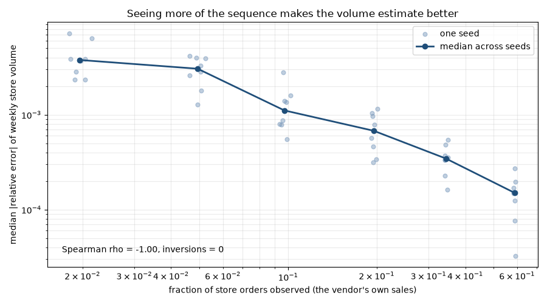
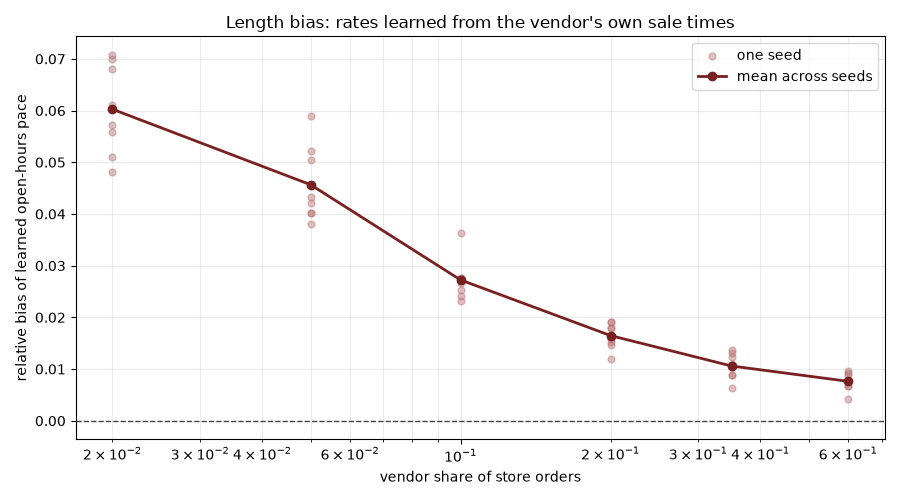

# ordergaps

**Forecast error added by the partial view: +0.40%** (a null: across the 8 seeds at this share it runs between -2.08% and +2.30%, sd 1.47%; across the 6 shares between -0.59% and +1.26%; a negative value means the estimated history did better than the truth by chance). A weekday-average forecast of daily store orders trained on the history this repo estimates from one vendor's own sales (vendor share 0.10) misses by 14.60 orders a day (MAE), vs 14.54 when trained on the true history (simulated store, 336 test days, Results section 4).

Next week's orders, day by day: the daily forecasts miss 5.64% vs 6.78% for last week's numbers (WAPE over the 7 days, store total; not the error on the week's sum); your own orders: 16.68% vs 21.77%.

How much does the whole store sell? Exact order-number arithmetic + a temporal allocation model, validated against a simulator with ground truth.

**Try it (60 s):** the Gap Explorer page at https://chasebak.github.io/ordergaps/ (or locally: `python -m http.server -d docs`) lets you drag the share of store orders you see between 2% and 60% and watch one simulated week become countable; every number on it comes from `python -m ordergaps.viz build`.

[](https://github.com/chasebak/ordergaps/actions/workflows/ci.yml)




## Quickstart

```bash
git clone https://github.com/chasebak/ordergaps && cd ordergaps
python3 -m venv .venv && source .venv/bin/activate
pip install -e . -r requirements-ci.txt
python -m pytest -q
python -m ordergaps.demo
```

Supported platforms: macOS arm64 and Linux. The demo simulates a store,
estimates its volume from one vendor's sales, and writes `out/report.md`
plus figures; it finishes in a few seconds.

## The idea

A marketplace numbers every order store-wide in one sequence. A vendor only
sees the orders containing its own items. The method is **exact
sequential-ID arithmetic + a temporal allocation model**: the gap between
two consecutively-seen order numbers is exactly how many store orders
happened in between — ID arithmetic, not estimation.

Saw order #1007 and then order #1012? Exactly four store orders happened in
between. The inference problem is WHEN those unseen orders happened and
through WHICH channel (in-store vs online/after-hours). The serial-number
idea goes back to WWII production
estimation (Ruggles & Brodie 1947; Goodman 1954), but unlike the German
tank problem, totals here are known exactly from ID differences — the open
question is timing and channel.

Caveat that applies to every number below: "volume" means orders CREATED,
not fulfilled — cancelled, voided and test orders consume order numbers and
are counted.

## How the estimator works

1. **Sessions** — store hours per weekday (closed days allowed), each day's
   session stretched to its first/last seen register (in-store) order; a
   closed day with a seen register order counts as open.
2. **Learned in-store pace** — orders per open minute per weekday, learned
   only from gaps that sit fully inside one session; pooled fallback for
   thin weekdays.
3. **Gap attribution** — for consecutive seen numbers n1 < n2, unseen =
   n2 − n1 − 1. The wall-clock span is split into open/closed minutes per
   day. Fully inside a session → all in-store. Fully outside → all
   online/after-hours. Mixed → expected in-store = Σ_day open_minutes ×
   rate(weekday), in-store = min(unseen, expected), online = remainder;
   in-store spread across days ∝ minutes × rate, online ∝ closed minutes.
4. **Day classification** — `full` (session ends pinned by seen orders, at
   least one inside), `spread` (zero seen orders — the day is a share of
   one long gap), `partial`, `closed`. Only full days enter per-day
   averages; spread days count in weekly totals only.
5. **Weekly tables** — total / in-store / online volume, vendor orders,
   vendor share of in-store, and vendor basket stats (orders, totals,
   items/order).
6. **Dispersion check** — uniform spreading within a segment is the
   conditional distribution of homogeneous-Poisson arrivals given the
   count; a Poisson vs negative-binomial check on full-day counts is
   computed and reported with every run.
7. **Pathology handling** — out-of-order timestamps (note + skip gap),
   numbering resets (detected, series split, affected weeks flagged),
   voided orders (consume numbers; see the caveat above).

The simulator (`ordergaps.simulator`) provides the ground truth the
production system never had: seeded nonhomogeneous arrivals (weekday ×
hour-of-day), store hours with closed days, two channels, a focal vendor
with configurable share, and planted pathologies — void orders, a numbering
reset, rate drift over weeks.

## Results (simulated ground truth, frozen seeds)

All numbers in this section are computed by this repo's code on the frozen
evaluation config; regenerate them with
`python -m ordergaps.evaluation.run_all --outdir figures`.

### 1. Error vs fraction of orders observed (hero figure above)

| vendor share | fraction observed | median weekly volume error |
|---|---|---|
| 0.02 | 0.020 | 0.3771% |
| 0.05 | 0.049 | 0.3048% |
| 0.10 | 0.097 | 0.1108% |
| 0.20 | 0.195 | 0.0676% |
| 0.35 | 0.344 | 0.0345% |
| 0.60 | 0.588 | 0.0150% |

Acceptance band: Spearman rho = -1.000 (required <= -0.8), inversions = 0
(required <= 1) -> PASS. Weekly totals are already sub-percent at a 2%
vendor share because interior counts are exact ID arithmetic; the residual
error lives at week boundaries and anomaly-flagged weeks.

> **Why this metric.** Owner's question: If I see only my own share of the store's orders, how far off is my weekly store total?
> Kind of number: Simulated: the median over seeds of each run's median |est - true| / true over clean weeks (fully covered, no numbering reset); truth = the simulator's weekly totals.
> What would make it lie: Dropping hard weeks or picking seeds after the fact; the clean-week rule and the seeds are frozen, tests/test_acceptance.py holds the band and tests/test_readme_drift.py the printed numbers.

#### 1.1 Against a uniform-in-time baseline

The baseline takes the same gaps and the same unseen counts and spreads each gap evenly over its clock time, ignoring store hours, sessions and learned paces (`ordergaps.baseline`). Same seeds, same clean weeks. Regenerate with `python -m ordergaps.evaluation.run_all --outdir figures --baseline-outdir results`.

| vendor share | model (this repo) | uniform-in-time baseline | vs uniform (model - uniform) | clean weeks whose totals differ |
|---|---|---|---|---|
| 0.02 | 0.3771% | 0.5369% | -0.1598 pp: model lower | 29 of 48 |
| 0.05 | 0.3048% | 0.2563% | +0.0485 pp: uniform lower | 8 of 48 |
| 0.10 | 0.1108% | 0.1108% | 0.0000 pp: tie | 0 of 48 |
| 0.20 | 0.0676% | 0.0676% | 0.0000 pp: tie | 0 of 48 |
| 0.35 | 0.0345% | 0.0345% | 0.0000 pp: tie | 0 of 48 |
| 0.60 | 0.0150% | 0.0150% | 0.0000 pp: tie | 0 of 48 |

Totals are arithmetic; the model's value is the split and the day classes. Both allocators hand out the same unseen orders, so a week's total can differ only through a gap that straddles the week's boundary. Model lower at vendor share 0.02; tie at vendor share 0.10, 0.20, 0.35, 0.60; uniform lower at vendor share 0.05.

> **Why this metric.** Owner's question: Is the timing model worth anything for weekly totals, or would spreading each gap evenly over the clock do as well?
> Kind of number: Simulated: median |est - true| / true over clean weeks, the same weeks, gaps and unseen counts for both allocators; truth = the simulator's weekly totals.
> What would make it lie: A baseline fed different counts than the model (both must hand out the same total, and a week no gap straddles must come out identical: tests/test_baseline.py).

#### 1.2 Full-day yield

| vendor share | full days | non-closed days | full-day yield |
|---|---|---|---|
| 0.02 | 10 | 480 | 2.1% |
| 0.05 | 64 | 480 | 13.3% |
| 0.10 | 171 | 480 | 35.6% |
| 0.20 | 329 | 480 | 68.5% |
| 0.35 | 433 | 480 | 90.2% |
| 0.60 | 473 | 480 | 98.5% |

> **Why this metric.** Owner's question: How much of the store must I see before a single day's count means anything?
> Kind of number: Counted: the estimator's own day labels (FULL / non-closed days), pooled over seeds; no truth involved, so section 3's full-day error is what says FULL is earned.
> What would make it lie: A looser pin rule would raise the yield without making full days more exact (section 3 prints the per-day error on full days, measured against truth).

#### 1.3 Estimation KPIs

| KPI | formula | why it matters | compared against | what the software does to it | measured on | value now |
|---|---|---|---|---|---|---|
| Weekly volume error vs share | median \|est − true\| ÷ true over clean weeks | "How wrong am I at MY share?" | truth; the uniform-in-time baseline (section 1.1) | sub-percent at every share | synthetic truth (seeds 101..808) | model from 0.3771% at 0.02 to 0.0150% at 0.60; uniform from 0.5369% at 0.02 to 0.0150% at 0.60; model lower at vendor share 0.02; tie at vendor share 0.10, 0.20, 0.35, 0.60; uniform lower at vendor share 0.05 (results/baseline_yield.json: rows[*].model_weekly_err, rows[*].uniform_weekly_err) |
| Full-day yield | FULL days ÷ non-closed days, pooled over seeds | how much share you need before day-level numbers mean anything | across shares | rises with share | the estimator's own day labels (seeds 101..808) | from 2.1% at 0.02 to 98.5% at 0.60 (results/baseline_yield.json: rows[*].full_day_yield) |
| Channel-split error | median \|est in-store − true in-store\| ÷ true in-store, weekly | the in-store share is the number used with the store, so its error bar must hold up | truth | the model's weakest output, shown openly | synthetic truth (seeds 101..808) | 20.83% [IQR 20.15%, 21.07%] at vendor share 0.10 (results/baseline_yield.json: kpi.channel_err_median, kpi.channel_err_p25, kpi.channel_err_p75) |

Guarantees (tests, not KPIs): window exactness, 13713/13713 windows between seen orders match ground truth at vendor share 0.10 (results/baseline_yield.json: kpi.n_windows_exact, kpi.n_windows); tests/test_acceptance.py requires every window exact at every share and seed. It is exact by construction, so it is a test, not a KPI.

### 2. Length bias of the learned weekday rates

The rate estimator learns only from gaps fully inside sessions, and the
observation times are the vendor's own sales — busy periods are
oversampled, so the learned pace is biased UP, and more so the less you
see. This is a known limitation, quantified rather than hidden:

| vendor share | mean bias | IQR |
|---|---|---|
| 0.02 | +6.03% | [+5.47%, +6.86%] |
| 0.05 | +4.57% | [+4.02%, +5.08%] |
| 0.10 | +2.72% | [+2.50%, +2.75%] |
| 0.20 | +1.65% | [+1.51%, +1.83%] |
| 0.35 | +1.06% | [+0.89%, +1.25%] |
| 0.60 | +0.76% | [+0.67%, +0.90%] |



> **Why this metric.** Owner's question: Is the open-hours pace the estimator learns too high or too low?
> Kind of number: Simulated: minutes-weighted mean of (learned - true) / true over open weekdays; truth = orders the simulator created inside scheduled hours per open minute.
> What would make it lie: One seed or one share would hide the spread; the table prints the IQR across seeds and the figure every seed. The bias is intrinsic (the vendor's own sale times oversample busy hours), so it is reported, not tuned away.

### 3. Counted vs allocated (vendor share 0.10)

Error bars appear only where they belong — on the model-based rows:

| quantity | kind | error |
|---|---|---|
| window totals between seen orders | counted (ID arithmetic) | exact: 13713/13713 windows match ground truth |
| vendor share of orders, fully-pinned days | counted (sampling noise only) | mean abs deviation from true share: 0.0024 |
| per-day total volume, full days | counted (boundary spill only) | median rel err 0.82% |
| weekly in-store volume (channel split) | allocated (model) | median rel err 20.83% [IQR 20.15%, 21.07%] |
| per-day total volume, partial/spread days | allocated (timing model) | median rel err 0.86% [IQR 0.71%, 1.03%] |

> **Why this metric.** Owner's question: Which of these numbers are counted, and which are the model's guess?
> Kind of number: Counted rows come from order-number arithmetic and are checked window by window against the orders the simulator created; allocated rows are the timing model's output, scored against simulator truth with an IQR across seeds.
> What would make it lie: A timestamp-precision slip or a mishandled numbering reset would break exactness; tests/test_acceptance.py requires every window exact at every share and seed.

The channel split is the weak joint, and the simulator says why: online
orders placed during open hours are attributed in-store by construction.
Totals stay near-exact; the split is honest model output.

### 4. Forecasting daily orders (rolling-origin backtest)

Setup: the frozen config above at vendor share 0.10; forecasting seeds 1101..1808 (pre-registered in PREDICTIONS.md); 28-day warm-up, 7-day horizon, an origin every 7 days: 6 origins per seed, 48 folds, 336 test days per series. At every origin the estimator is re-run on the orders seen before it, and the incomplete last day is dropped from both store histories. Regenerate with `python -m ordergaps.evaluation.forecast_experiment --outdir results` (writes results/, which this section copies; `--check` verifies the committed copy).

Headline: forecast error added by the partial view = +0.40% (weekday average: MAE 14.60 trained on the estimated history vs 14.54 trained on the true history), (a null: across the 8 seeds at this share it runs between -2.08% and +2.30%, sd 1.47%; across the 6 shares between -0.59% and +1.26%; a negative value means the estimated history did better than the truth by chance).

Owner view: next week's store orders, day by day, the weekday average's daily forecasts miss 5.64% (WAPE) vs 6.78% for last week's number; your own orders, 16.68% vs 21.77%.

#### 4.0 Forecast KPIs

| KPI | formula | why it matters | compared against | what the software does to it | measured on | value now |
|---|---|---|---|---|---|---|
| **Forecast error added by the partial view** (headline) | weekday-average MAE trained on re-estimated history ÷ the same trained on true history − 1 (same training and test days) | near 0 means one vendor can forecast the whole store from its own receipts | the same forecaster trained on full truth | rebuilds the history it learns from | synthetic truth | +0.40% (results/forecast_summary.json: headline.added) |
| Next-week orders, owner view | WAPE = Σ\|daily error\| ÷ Σ daily actual over the next 7 days' store orders (day by day, not the error on the week's sum) | "% of orders missed"; defined on zero days | seasonal naive | fewer orders missed | synthetic truth | 5.64% vs 6.78% (results/forecast_summary.json: owner) |
| Beats naive out of sample? | test MAE ÷ seasonal-naive test MAE; MASE beside it | does it beat what anyone would do by hand? | seasonal naive, same test days | below 1 means the software wins | synthetic truth | 0.832; MASE 0.823 (results/forecast_summary.json: tables.store_est.weekday_avg) |
| 80% interval coverage vs achievable | share of test days inside the 80% interval, beside the oracle's expected coverage | restock and cash need a range | the oracle's achievable coverage | shows whether the interval is honest | synthetic truth | 0.750 vs 0.811 (results/forecast_summary.json: tables.store_est.weekday_avg) |

Guarantees (tests, not KPIs): no look-ahead (changing orders after an origin leaves that fold unchanged; a run-once implementation fails the same test); full-view identity (share 1.0, no voids: the headline is exactly 0); poisson_quantile(10, 0.025) = 4 and poisson_quantile(10, 0.975) = 17; seasonal naive has zero error on an exactly weekly series.

#### 4.1 Store total, trained on the estimated history

| model | MAE mean ± sd | WAPE | MASE | beats naive? (MAE ratio) | 80% coverage | 95% coverage | achievable 80% / 95% |
|---|---|---|---|---|---|---|---|
| seasonal naive (same weekday last week) | 17.55 ± 6.08 | 6.78% | 0.990 | baseline (1.000) | 0.655 | 0.860 | 0.811 / 0.954 |
| 28-day average (context: weekday-blind) | 59.14 ± 3.81 | 22.84% | 3.304 | no (3.371) | 0.411 | 0.542 | 0.811 / 0.954 |
| weekday average (last 4) | 14.60 ± 4.27 | 5.64% | 0.823 | yes (0.832) | 0.750 | 0.908 | 0.811 / 0.954 |
| oracle: true expected count (floor) | 12.21 ± 3.66 | 4.72% | 0.688 | yes (0.696) | 0.827 | 0.961 | 0.811 / 0.954 |

> **Why this metric.** Owner's question: How many orders will the whole store take next week, from my own receipts?
> Kind of number: Forecast, scored out of sample against the simulator's true daily totals; the history it learns from is this repo's estimate, re-run at each origin.
> What would make it lie: Look-ahead (guarded by the poison test in tests/test_backtest.py) and Poisson arrivals by construction (no real-day shocks: see What this does NOT claim).

#### 4.2 Store total, trained on the true history

| model | MAE mean ± sd | WAPE | MASE | beats naive? (MAE ratio) | 80% coverage | 95% coverage | achievable 80% / 95% |
|---|---|---|---|---|---|---|---|
| seasonal naive (same weekday last week) | 16.85 ± 6.36 | 6.51% | 0.933 | baseline (1.000) | 0.655 | 0.866 | 0.811 / 0.954 |
| 28-day average (context: weekday-blind) | 59.15 ± 3.81 | 22.84% | 3.232 | no (3.510) | 0.411 | 0.542 | 0.811 / 0.954 |
| weekday average (last 4) | 14.54 ± 4.28 | 5.62% | 0.803 | yes (0.863) | 0.744 | 0.911 | 0.811 / 0.954 |
| oracle: true expected count (floor) | 12.21 ± 3.66 | 4.72% | 0.674 | yes (0.725) | 0.827 | 0.961 | 0.811 / 0.954 |

> **Why this metric.** Owner's question: How good could the same forecast be if I saw every store order?
> Kind of number: Forecast trained on the TRUE totals of exactly the same training days; it is the reference for the headline.
> What would make it lie: Unequal training days on the two sides (guarded by the matched-days and full-view identity tests in tests/test_backtest.py).

#### 4.3 Your own orders

| model | MAE mean ± sd | WAPE | MASE | beats naive? (MAE ratio) | 80% coverage | 95% coverage | achievable 80% / 95% |
|---|---|---|---|---|---|---|---|
| seasonal naive (same weekday last week) | 5.65 ± 1.50 | 21.77% | 1.023 | baseline (1.000) | 0.652 | 0.851 | 0.834 / 0.961 |
| 28-day average (context: weekday-blind) | 7.56 ± 1.37 | 29.14% | 1.370 | no (1.338) | 0.551 | 0.696 | 0.834 / 0.961 |
| weekday average (last 4) | 4.33 ± 1.07 | 16.68% | 0.787 | yes (0.766) | 0.795 | 0.943 | 0.834 / 0.961 |
| oracle: true expected count (floor) | 3.80 ± 1.09 | 14.65% | 0.689 | yes (0.673) | 0.851 | 0.970 | 0.834 / 0.961 |

> **Why this metric.** Owner's question: How many orders will I myself get next week?
> Kind of number: Forecast of the vendor's own daily orders, which are counted directly; truth = the simulator's realized vendor orders.
> What would make it lie: The simulated vendor also sees online orders (a real vendor sees register sales only); the oracle row shows how much is pure noise.

#### 4.4 Forecast error added by the partial view, by share

| vendor share | MAE trained on estimates | MAE trained on truth | error added |
|---|---|---|---|
| 0.02 | 14.43 | 14.51 | -0.59% |
| 0.05 | 14.73 | 14.54 | +1.26% |
| 0.10 | 14.60 | 14.54 | +0.40% |
| 0.20 | 14.47 | 14.54 | -0.47% |
| 0.35 | 14.52 | 14.54 | -0.13% |
| 0.60 | 14.51 | 14.54 | -0.22% |

Spread at vendor share 0.10: the same ratio pooled per seed runs between -2.08% and +2.30% across the 8 seeds (sd 1.47%), so the headline +0.40% is a null: the per-seed values straddle 0.

> **Why this metric.** Owner's question: Does seeing only part of the store cost me forecast accuracy?
> Kind of number: Ratio of two forecast MAEs on the same test days and training days, minus 1; near 0 means the partial view costs nothing.
> What would make it lie: Different training days (one side keeping the incomplete last day): the full-view identity test requires exactly 0 at share 1.0.

#### 4.5 Backtest checks (vendor share 0.10)

| check | value |
|---|---|
| training days a single run over all the data would rewrite | 464 of 2024 |
| learned weekday paces it would rewrite | 288 of 288 |
| dropped last day: estimated ÷ true orders | 0.9674 |
| training days per fold (mean); share of them full days | 42.17; 27.67% |
| test days with zero actual orders (all three series) | 0 |

> **Why this metric.** Owner's question: Is the backtest itself honest?
> Kind of number: Counted checks on the backtest's own inputs: what a single run over all the data would rewrite, and what the dropped last day held.
> What would make it lie: A run-once implementation; tests/test_backtest.py shows the poison test fails on one.

#### 4.6 Pre-registered predictions (PREDICTIONS.md, 2026-11-04)

- P1: weekday average MASE < 28-day average MASE (store, estimated history). Observed: 0.823 vs 3.304 -> PASS
- P2: weekday average test MAE / seasonal naive test MAE < 1. Observed: 0.832 -> PASS
- P3: forecast error added by the partial view < 5% at every share >= 0.05. Observed: 0.05: +1.26%; 0.10: +0.40%; 0.20: -0.47%; 0.35: -0.13%; 0.60: -0.22% -> PASS
- P4: seasonal naive 80% coverage <= achievable 80% coverage - 0.10. Observed: 0.655 vs achievable 0.811 -> PASS
- P5: oracle 80%/95% coverage within 3 Poisson-binomial SE of achievable. Observed: store_est 80%: 0.827 vs 0.811 (z +0.78); store_est 95%: 0.961 vs 0.954 (z +0.67); vendor 80%: 0.851 vs 0.834 (z +0.84); vendor 95%: 0.970 vs 0.961 (z +0.85) -> PASS
- B1: the oracle has the lowest pooled MAE in every series. Observed: store_est 12.21 vs best other 14.60; store_true 12.21 vs best other 14.54; vendor 3.80 vs best other 4.33 -> PASS

## Which data this uses

The method needs only what one vendor can see: its own orders. Kinds of data
only; real values (order numbers, number ranges, counts, sales) never appear
in this repo, because the store-wide order numbers alone would reveal the
store's total orders.

| data | in the real system? | in the simulator? | used by |
|---|---|---|---|
| store-wide order number of each order holding my items | yes, read from the store's stock-adjustment history | yes (`orders.order_number`) | `gaps` (unseen = n2 − n1 − 1), `gaps.split_eras` (numbering resets) |
| time each of those orders was created | yes | yes, weekday × hour-of-day Poisson arrivals | `gaps`, `sessions`, `rates`, `attribution`, `classify` |
| channel of each seen order | register sales only: online orders are never seen | register and online, and the vendor sees both | `sessions` (register orders stretch the day), weekly vendor share of in-store |
| my items and $ per seen order | yes, at list price (discounts are invisible) | yes, simulated baskets | `estimator` weekly basket stats (optional `items`, `total` columns) |
| store hours and closed days | the posted schedule, entered by hand | `config.default_weekly_hours` | `sessions`, `attribution`, `classify` |
| voided / cancelled orders | not seen; they only use up numbers | planted (`void_rate`) | counted inside the gaps (see the "volume" caveat) |
| restocks and stock levels | yes | no | not used yet |
| true store volume per day and channel | never | yes (`truth_daily`, `truth_weekly`, true weekday pace) | `evaluation/` only: every error number above |
| true EXPECTED orders per day | never | yes (`simulator.true_daily_mean`, no random draws) | the forecast oracle only (section 4) |

Cadence: in the real system each pull re-reads every item's full stock
history, so the order record stays continuous even though pulls are
irregular; the estimator is rerun weekly on that record. The simulator
produces the same columns (`order_number`, `created_at`, `channel`, `items`,
`total`) that `estimate()` takes as input.

## Production use

I run this estimator weekly on my own business's sales history to size the
store my items sell in. That data is private, so no store-linked numbers
appear here: every result number in this README is a simulator result from
the frozen config above, regenerated by the command in "Results".

## Design decisions / what didn't work

- **Spread days are excluded from per-day averages.** A spread day's count
  is just one long gap's model share — it carries no day-level signal, and
  averaging it in feeds the rate model its own output back.
- **The length-bias finding stays in.** First instinct was to "fix" the
  learned rates; the honest move was to quantify the bias (table above)
  and report it, since it is intrinsic to observing the sequence through
  the vendor's own sales.
- **Pin tolerance had to be relative.** The first rule pinned a session end
  only when ~1 expected order could hide past the boundary; at realistic
  shares the expected boundary wait is ~1/share orders, so almost no day
  ever classified as full. The shipped rule is max(5 orders, 5% of the
  day's expected total).
- **Timestamp precision bug.** Converting pandas Timestamps through
  `np.datetime64(ts)` silently truncates to microseconds and broke the
  window-exactness verification; `Timestamp.to_datetime64()` preserves
  nanoseconds. The exactness test exists to catch exactly this class of
  bug.
- **Simulator regimes were tuned on trial seeds, then frozen.** The
  committed figures and tables use seeds that were fixed before the
  committed results were generated, never adjusted after.
- **Forecasting was pre-registered.** [PREDICTIONS.md](PREDICTIONS.md) fixed
  the seeds, the fold count, the metric choices and P1–P5 before the first
  frozen run; [DECISIONS.md](DECISIONS.md) records each forecasting choice
  with the measurement behind it (time-series folds instead of shuffled
  k-fold, re-estimating at every origin, matched training days, WAPE
  instead of MAPE).

## What this does NOT claim

- No German-tank-problem optimality (no MVUE claims): totals come from ID
  differences, not serial-number extrapolation.
- Not fulfillment counts: "volume" = orders CREATED (voids, cancellations
  and test orders consume numbers and are counted).
- The channel split is model-based, not counted (see table 3 for its
  error); only totals and fully-pinned day counts are near-exact.
- No claim that the timing model beats a uniform-in-time split on weekly
  totals: they tie at most shares, the uniform split is lower at one, and
  section 1.1 prints both. Totals are arithmetic; the model's value is the
  split and the day classes.
- Rates assume within-session homogeneity; the dispersion check (Poisson
  vs negative binomial on full-day counts) is computed and reported with
  every run, and the demo shows it flagging planted rate drift.
- Simulated results are statements about the simulated regimes, not about
  any particular real store.
- The forecasts are simulator-only: no real-data forecast score is
  published. The simulator's arrivals are Poisson by construction, so
  Poisson intervals and the weekday average look good partly by design;
  real days have shocks (releases, events, sold-out shelves) that it does
  not plant.
- The oracle row is a floor for these simulated regimes, not a bound on
  real stores; "sales" here means orders per day, not units or dollars.
- The Gap Explorer page shows one simulated week of one seed; its tiles
  and tables are the same medians over seeds as this README, and the page
  computes nothing in the browser (it only looks up `docs/data/*.json`).
  It is not deployed yet: GitHub Pages is switched on by hand.

## What to improve next

- A forecast view on the Gap Explorer page: scrub the backtest origin and
  toggle "trained on what you see / on full truth" (section 4's numbers are
  already in `results/forecast_summary.json`; the page view is not built).
- A weekly roll-up row on the page, and a register-only vendor toggle.
- How much history is enough: the backtest at more history lengths.
- A Poisson / negative-binomial regression with planted releases, and
  sold-out days (sales are not demand).

## Repo map

- `src/ordergaps/` — estimator (`sessions`, `rates`, `attribution`,
  `classify`, `dispersion`, `estimator`), `simulator`, `forecast` (the
  easiest forecasts and Poisson intervals), `backtest` (leak-free rolling
  origins), `baseline` (the uniform-in-time allocator), `viz` (the Gap
  Explorer's page data), `evaluation/` (`run_all`, `forecast_experiment`),
  `demo`.
- `tests/` — gap-arithmetic exactness, session stretching, mixed-gap
  attribution, pathologies (out-of-order, reset, voids), dispersion check,
  evaluation reproducibility and the frozen acceptance band; forecast
  fixtures, the no-look-ahead poison test, the full-view identity, oracle
  parity and calibration, frozen-hash and README-drift guards; the page
  data's parity, daily conservation, worked-gap exactness, privacy and
  time-zone determinism (`test_viz.py`).
- `results/` — committed generated outputs: the forecast folds, origins,
  summary JSON and the README's section 4
  (`python -m ordergaps.evaluation.forecast_experiment --outdir results`),
  and sections 1.1 / 1.2 (`baseline_yield.md` / `.json`, written by
  `run_all --baseline-outdir results`).
- `docs/` — the Gap Explorer page (`index.html`, `app.js`, the page kit's
  `tokens.css`) and its data (`docs/data/*.json`), written by
  `python -m ordergaps.viz build`; `--check` fails if the data are stale.
- [PREDICTIONS.md](PREDICTIONS.md), [DECISIONS.md](DECISIONS.md) — the
  pre-registered forecast predictions and the dated decision log.
- `figures/` — committed PNGs generated by
  `python -m ordergaps.evaluation.run_all --outdir figures`.

Provenance: The estimator my business uses to size its market, rebuilt
against a simulator with ground truth.

References: Ruggles & Brodie (1947); Goodman (1954) — full citations and
the model write-up are in [MODEL.md](MODEL.md).

Part of a set of public repos extracted from my card-business tooling — see
my GitHub profile for the map.
